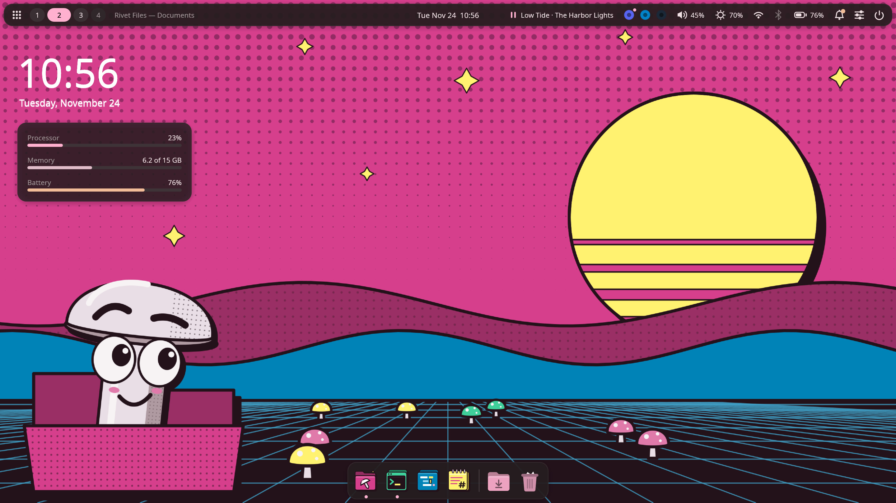

Rivet has a shell now. It is early. There is no release yet, so you build it from source, and you should expect rough edges and changes.

It is a Wayland desktop in the same look as the other Rivet apps: a panel, a dock, widgets, and the wallpaper, plus a settings window. The apps still start on their own. You do not need the shell to use them.



## What is on screen

The panel can sit at the top or the bottom, floating or edge to edge. It can show a launcher button, workspaces (on niri, Hyprland, and Sway), the focused window's title, a clock that opens a calendar, what is playing, volume and brightness, network, battery, notifications, quick settings, and a power menu. You can have more than one panel, on every screen or on one, and pick what goes in the left, center, and right of each.

Quick settings hold the sliders and toggles (volume, brightness, Wi-Fi, Bluetooth, night light, and the rest), what is playing, and the notification history. If mako or dunst is already running, the shell leaves notifications to them. Volume and brightness also show on screen as they change.

The dock lists pinned apps, then other apps that have windows open. A dot marks the ones with a window (on niri and Hyprland). Right-click an icon to pin it, unpin it, or move it. It can auto-hide, or stay up only while the workspace has no windows. A fresh config pins Files, Terminal, Edit, Notes, and Firefox.

The launcher searches installed apps as you type. Widgets on the desktop are a large clock and the date, processor, memory, and battery.

## Where it runs

It needs a compositor with the wlr layer-shell protocol: niri, Hyprland, Sway, river, labwc, Wayfire, and COSMIC. GNOME is not one of them. If another bar is already up (Waybar, Noctalia, and the like), stop it first, or both will be on screen.

A few controls only appear when the matching tool is installed: `wpctl` for volume, `brightnessctl`, `nmcli`, `bluetoothctl`, `playerctl`, `powerprofilesctl`, `gammastep` or `hyprsunset` or `wlsunset` for night light, and `loginctl` and `systemctl` for power. If one is missing, that control simply does not show.

## Colors

Settings has three ways to color the shell, and the Rivet apps follow them. Colors can come from the wallpaper, with matugen when it is installed. They can come from a built-in palette. Or they can be a light or dark style, an accent, and a surface color. Change the wallpaper or the colors and the running shell updates at once. The apps that read those colors follow along, with no restart.

## The other apps, and Welcome

Files, Notes, Edit, Terminal, and FTP keep working without the shell. The dock is one way to start the ones you pin. Welcome is optional and already has a pre-release: it installs and updates apps from their GitHub releases, checks the sha256, and can sit in the shell's tray. The shell itself has no release, so Welcome cannot install it yet.

Build it from the top of the [repository](https://github.com/rivetsoft/apps):

```sh
cargo build --release -p rivet-shell
./target/release/rivet-shell
```

More is on the [Shell page](/docs/shell/) and in the [Shell README](https://github.com/rivetsoft/apps/blob/main/apps/rivet-shell/README.md), including how to start it from niri, Hyprland, or Sway.
