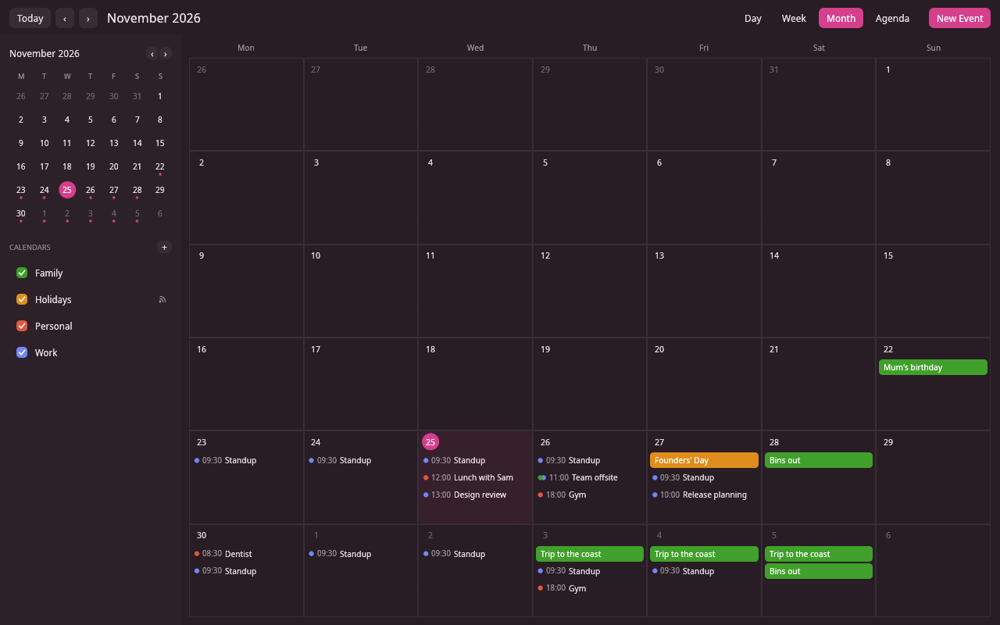

Rivet Calendar shows your days as a month, a week, a day or a list. Events are kept in plain `.ics` folders that vdirsyncer and khal share.



## Events

Make, change and delete events, whole-day ones too. Repeat one every day, weekday, week, month or year, then change or delete a single occurrence or all of them. A rule made in another program is kept as it is, and so are alarms, attendees and anything else Rivet doesn't show.

Calendars are listed in the sidebar. Click one to show or hide it, right-click to rename it, recolor it or move it to the Trash, and use + to make another. The small month there marks the days with events.

## Accounts and subscriptions

Add an account from + beside Calendars:

- **CalDAV:** Nextcloud, Fastmail, iCloud (with an app password), Radicale and others. The password is kept in the keyring.
- **Google** and **Microsoft:** sign in in your browser. Calendars shared with you to look at stay read-only.

Their calendars sync both ways, every 5 minutes and a few seconds after you change something. When an event changed on both sides, the server's is kept. Right-click one of its calendars to sync now or remove the account.

Subscribe to a feed (holidays, a shared calendar, a `webcal://` link) from the same + menu, or by opening the link with Rivet Calendar. It's read again every 6 hours. Opening an `.ics` file adds its events to a calendar you choose.

## Files

| File | What |
| --- | --- |
| `~/.local/share/rivet-calendar/NAME/` | A calendar: one `.ics` per event, its name in `displayname`, its color in `color` |
| `~/.config/rivet-calendar/accounts` | Accounts (passwords and sign-ins are in the keyring) |

## In Rivet Shell

Turn on **Calendar** in Settings, Plugins. Days with events get a dot in each calendar's color in the panel's calendar, and the chosen day's events are listed under the month. Click one to open it in Rivet Calendar.

## Keys

`T` today, `Left` and `Right` back and on, `D` `W` `M` `A` for the views, `N` a new event, `Esc` closes the editor.

## In the terminal

```sh
rivet-calendar list 14                      # the next fortnight
rivet-calendar subscribe webcal://…/a.ics
rivet-calendar account add google
rivet-calendar sync
```

## Get it

The current downloads are on the [Calendar page](/calendar/). Build from the repo with:

```sh
cargo build --release -p rivet-calendar
./target/release/rivet-calendar --install-desktop-entry
```

More is in the [Calendar README](https://github.com/rivetsoft/apps/blob/main/apps/rivet-calendar/README.md).
