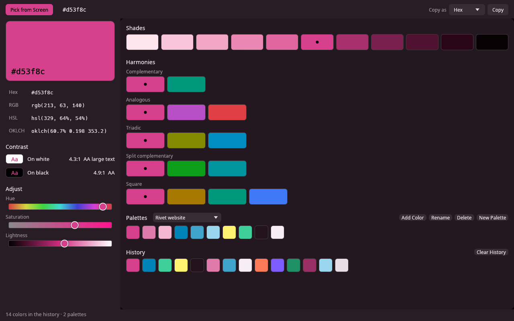

Rivet Color picks a color from anywhere on the screen and copies it in the format you chose last: hex, RGB, HSL or OKLCH.



## Picking

Click **Pick from Screen**, or press `P`. On niri, Hyprland, Sway and other compositors with layer-shell, with `grim` installed, the screen holds still and a loupe beside the pointer shows the pixels around it. Click or `Enter` picks. `Escape` or a right-click stops. The wheel zooms. The arrow keys move one pixel, ten with `Shift`.

Elsewhere it uses what is there: niri's own picker, `hyprpicker`, `slurp` with `grim`, or the desktop's picker on GNOME and KDE.

## Copying

Click a format to copy the color in it. **Copy as** sets the format every copy uses: the window, the panel and `rivet-color pick`. Copying from the panel or the command line needs `wl-copy` (wl-clipboard).

## Shades, harmonies and contrast

Five tints and five shades, and complementary, analogous, triadic, split complementary and square harmonies, turned in OKLCH so they look as light as the color they start from. Click any of them to look at it instead. Contrast is shown on white and on black, with the WCAG grade.

## History and palettes

The colors you pick and copy are kept, the latest first. Right-click any swatch to copy it, add it to a palette, or remove it. Palettes are GIMP palette files, which GIMP, Inkscape and Krita open too. Your desktop's own colors are there as a palette.

| File | What |
| --- | --- |
| `~/.local/share/rivet-color/history` | The history, one `#rrggbb` a line, the latest first |
| `~/.local/share/rivet-color/palettes/*.gpl` | Palettes, in GIMP's format |
| `~/.config/rivet-color/settings` | `format=hex`, `rgb`, `hsl` or `oklch` |

## In Rivet Shell

Turn on **Color** in Settings, Plugins, then add its item to a panel. It shows the color picked last. Click it for Pick a Color and recent colors. Middle-click picks. Right-click opens Rivet Color. In the launcher, `@color` lists the history and palettes, and `@color #d53f8c` copies that color in your format.

## A key binding

Bind `rivet-color pick`. It picks, copies, keeps the color in the history and shows a notification. For Softcore:

```
bind.Mod+P=spawn rivet-color pick
```

## Get it

The current downloads are on the [Color page](/color/). Build from the repo with:

```sh
cargo build --release -p rivet-color
./target/release/rivet-color --install-desktop-entry
```

More is in the [Color README](https://github.com/rivetsoft/apps/blob/main/apps/rivet-color/README.md).
