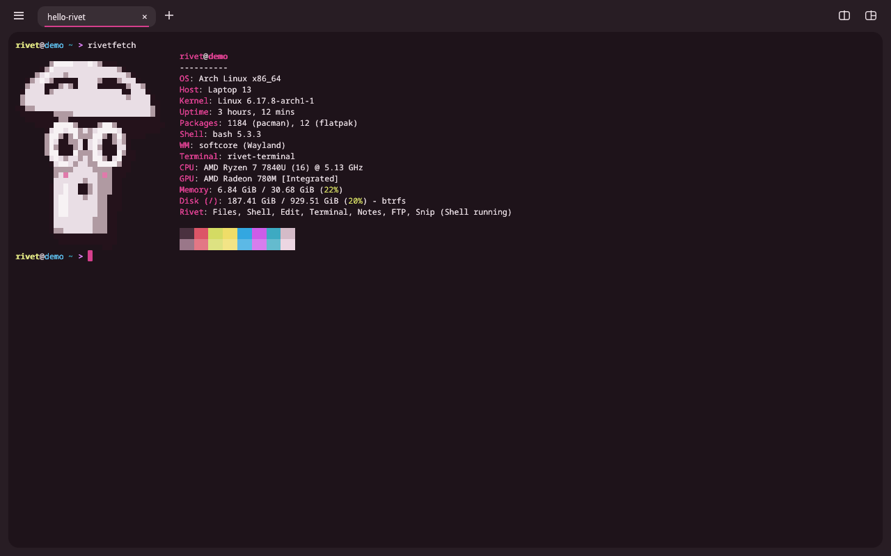

`rivetfetch` shows this computer at a glance in the terminal, beside Rivet the mascot, in the desktop's accent.



The mascot is drawn from his pixel art, two pixels to a character cell. It needs a terminal with color; plain output leaves him out. Every module runs at once, so it takes about 30 ms.

## What it shows

By default: OS, host, kernel, uptime, packages, shell, window manager, CPU, GPU and memory. `rivetfetch --list-modules` lists the rest: screens, theme, icons, font, cursor, terminal, swap, disk, battery, locale, the Rivet apps installed, and the terminal's 16 colors.

```sh
rivetfetch --logo none                       # the facts alone
rivetfetch --modules os,kernel,memory,rivet  # what to show, in that order
rivetfetch --pipe                            # no color, for scripts
```

`--structure os:kernel` works as well as `--modules`, as fastfetch takes it. A fastfetch logo file, with `$1` to `$9` for its colors, works with `--logo`.

## Settings

`~/.config/rivet-fetch/settings`, one `key=value` per line. Command-line options win over the file.

```
logo=none             # mascot, none, or a path to a logo file
modules=title,separator,os,host,kernel,uptime,memory,rivet
color=auto            # auto, always or never
```

## Where the facts come from

Nearly everything is read from the kernel's own files (`/proc`, `/sys`, `/etc/os-release`). The exceptions are the shell's version, the GTK look (`gsettings` or GTK's `settings.ini`) and RPM's package count. A module that can't find out shows nothing.

## Get it

The current downloads are on the [Fetch page](/fetch/). It has no window, so run `rivetfetch` in a terminal. Build from the repo with:

```sh
cargo build --release -p rivet-fetch
./target/release/rivetfetch
```

More is in the [Fetch README](https://github.com/rivetsoft/apps/blob/main/apps/rivet-fetch/README.md).
