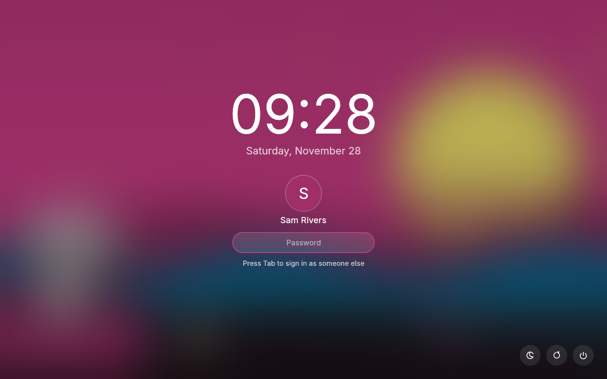

Rivet Greeter is a login screen for greetd. It is Rivet Shell's lock screen as the screen you sign in from: the same clock, picture, password field and power buttons, over the wallpaper and in the colors you chose last.



It shows whoever changed their wallpaper last. Tab or the arrow keys go to the next account. When the password is right, greetd starts the session you were using last, else the first Wayland session installed. An account that asks for more than a password, such as a one-time code, can't sign in from it yet.

## Setting it up

You need greetd and a compositor that shows one program: cage, Sway or [Softcore](/docs/softcore/).

```sh
cargo build --release -p rivet-greeter
sudo install target/release/rivet-greeter /usr/local/bin/
sudo rivet-greeter --setup
```

`--setup` makes `/var/lib/rivet-greeter` and prints the lines for greetd. Put one of these in `/etc/greetd/config.toml`:

```toml
[default_session]
command = "cage -s -- rivet-greeter"
# command = "softcore --greeter rivet-greeter"
user = "greeter"
```

With Sway, put `exec "rivet-greeter; swaymsg exit"` in a file and use `command = "sway --config FILE"`. Then change your wallpaper, or run `rivet-greeter sync`, and restart greetd.

## Your wallpaper on the login screen

greetd runs the greeter as its own user, which can't read anyone's home folder. So each person's session leaves a copy of their wallpaper, colors, clock, name, picture (`~/.face`) and session in `/var/lib/rivet-greeter`, in a folder named for their login.

- **Under Rivet Shell** this happens by itself whenever the wallpaper or its colors change.
- **On any other desktop**, run `rivet-greeter sync`. It takes your desktop's colors the way every Rivet app does ([How colors work](/docs/colors/)) and the picture you give it:

```sh
rivet-greeter sync --wallpaper ~/Pictures/dusk.png
rivet-greeter sync --wallpaper ~/Pictures/dusk.png --clock "%-I:%M %p" --name "Sam Rivers"
```

Run it again after changing the wallpaper, or from your wallpaper program's own hook. Without `--wallpaper` it updates the colors and keeps the picture left before.

The folder works like `/tmp`: anyone can add their own folder, and nobody can change another's. The greeter only reads a folder, and the files in it, when the account it's named for owns them. Nothing private goes there, and never a password.

## Coming from `rivet-shell greeter`

Rivet Shell 0.1.2 was its own greeter. `rivet-shell greeter` still works for now: it runs `rivet-greeter` with the same words, or says how to get it when it isn't installed. The folder hasn't changed, so wallpapers already left there show as before. Change `rivet-shell greeter` to `rivet-greeter` in greetd's settings; a later Rivet Shell drops the old command.

## Get it

There is no release yet. Build it from the [Rivet Greeter README](https://github.com/rivetsoft/apps/blob/main/apps/rivet-greeter/README.md).
