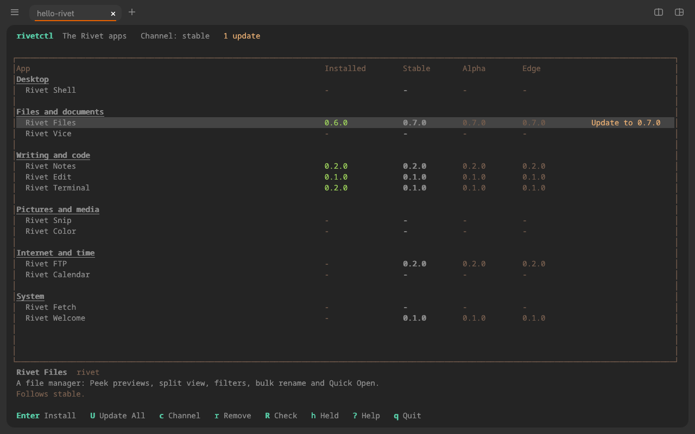

`rivetctl` is Rivet Welcome for the terminal. Run it on its own for a full-screen list of every app, or give it a command for scripts. It uses the same engine as Rivet Welcome, so the two always agree on what's installed and never install the same app at once.



## The list

Run `rivetctl` with nothing after it. The apps are grouped by category, with the version installed and what each channel offers.

- **Enter** installs the app, or its update. **U** installs every update.
- **c** chooses the app's channel. An installed app moves to that channel's version straight away.
- **r** removes the app. Its settings and your documents stay.
- **R** looks for new releases, **h** shows the apps held back from release, **?** lists the keys and **q** quits.

## Commands

```sh
rivetctl list                          # every app, installed and offered
rivetctl install notes edit            # install, or update
rivetctl install notes --channel edge  # from the edge channel, from now on
rivetctl update                        # every update (or: update notes)
rivetctl remove notes                  # its settings and notes stay
rivetctl channel notes alpha           # stable, alpha, edge, or default
rivetctl build fetch@main              # from source at a branch, tag or commit
rivetctl doctor                        # what's missing here, and what to install
```

Add `--json` to `list`, `install`, `update`, `remove`, `channel` or `doctor` for output a script can read.

## Channels

Every app follows the channel chosen in [Rivet Welcome](/docs/welcome/#which-versions) (stable when there's none). One app can follow another: `rivetctl channel notes edge`. Rivet Welcome keeps that app on its channel too. `rivetctl channel notes default` puts it back.

Edge is a build of each app's newest code, made every night. It can break, so keep backups of what you use it with.

## Building from source

`rivetctl build APP@REF` builds an app from a branch, tag or commit (`main` when there's none) and installs it, the same way the repository's own installer does. Rivet Reader's PDF library comes with it. It needs git and Rust, and keeps a copy of the source in `~/.cache/rivetctl/source` so the next build is quicker.

## For AI assistants

`rivetctl mcp` is a Model Context Protocol server. Add it to an assistant as a local server whose command is `rivetctl mcp`. The assistant can then list the apps, check one, install, update and remove them, and run `doctor`. Installing, updating and removing change nothing until the assistant confirms; until then, it gets back what would happen, to show you first.

## Get it

```sh
cargo build --release -p rivetctl
./target/release/rivetctl
```

More is in the [rivetctl README](https://github.com/rivetsoft/apps/blob/main/apps/rivetctl/README.md).
