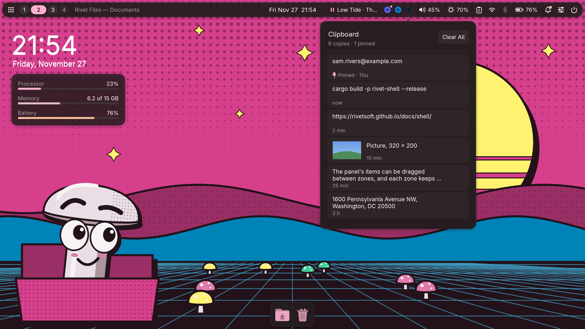
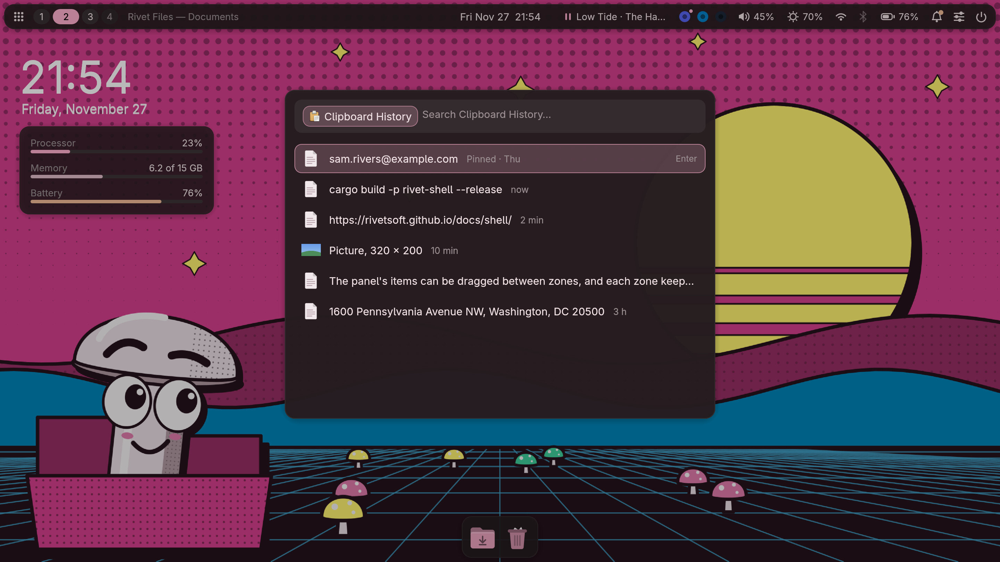

Rivet Shell keeps the text and pictures you copy, so you can copy them again later. Open the list from the panel's Clipboard item, type `@clip` in the launcher, or bind a key to `rivet-shell msg clipboard`.



Choose a copy and it is on the clipboard again, ready to paste. Hover a copy to pin it or remove it. Pinned copies stay at the top, and Clear All leaves them in place. In the popup, the arrow keys choose a copy, Enter copies it and Delete removes it.

## In the launcher

Type `@clip` and the launcher lists the history. Keep typing to search it.



## From a key

```sh
rivet-shell msg clipboard          # open or close the list
rivet-shell msg clipboard 2        # copy the second copy in the list again
rivet-shell msg clipboard clear    # clear the copies that aren't pinned
```

Pinned copies come first in the list, so `clipboard 1` is the first pinned copy when you have one.

## Settings

The Clipboard page in Settings turns the history on or off, sets how many copies it keeps (50 at first, between 10 and 500; pinned copies don't count), and chooses whether it survives a restart.

- **Off forgets.** Turning the history off forgets every copy, pinned ones too.
- **Kept for the session by default.** Unless you choose to keep it, the history is gone when the shell ends.
- **Kept across restarts** writes it to `~/.local/share/rivet-shell/clipboard`, a file only your account can read. Turning that off deletes the file.

## What is kept

- Text, and pictures copied as PNG, JPEG or WebP. Files copied in a file manager, and rich text with no plain text alongside it, are left out.
- A text copy larger than 1 MB, or a picture larger than 16 MB, is skipped. Pictures that aren't pinned share 64 MB; past that the oldest go.
- Copying the same thing again moves it to the top instead of adding it twice.

Password managers such as KeePassXC mark a password they copy as secret. Rivet Shell never reads a copy marked that way. A password manager that doesn't mark its copies can't be told apart from other text.

## Where it works

The shell reads the clipboard through the compositor's data-control protocol (`ext-data-control-v1`, or the older `zwlr-data-control-v1`). Softcore, niri, Hyprland, Sway, river, labwc and Wayfire have it. Where it is missing, the Clipboard item, `@clip` and `rivet-shell msg clipboard` don't show.
