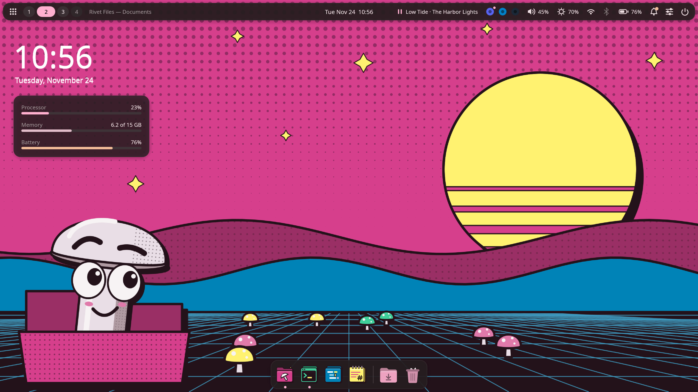

Rivet Shell is a Wayland shell. It draws a panel (you can have more than one), quick settings, notifications, an on-screen display, a dock, a launcher, widgets, and the wallpaper.



The launcher also evaluates a sum. Widgets include a clock, CPU, memory, and battery. Notifications stay out of the way when mako or dunst is already running.

It talks to the compositor with the layer-shell protocol. That covers niri, Hyprland, Sway, river, labwc, Wayfire, and COSMIC. GNOME is not one of them.

## Commands

```sh
rivet-shell
rivet-shell settings
rivet-shell msg launcher
rivet-shell msg control-center
rivet-shell msg volume up
rivet-shell msg wallpaper next
rivet-shell msg quit
rivet-shell --install-desktop-entry
```

`volume` also takes `down` and `mute`. `wallpaper` also takes `random`, `previous`, and a path.

Settings live in `~/.config/rivet-shell/settings`. Open the window with `rivet-shell settings`.

If a tool is missing, that control simply does not show. The list includes `wpctl`, `brightnessctl`, `nmcli`, `bluetoothctl`, `playerctl`, `powerprofilesctl`, `gammastep`, `hyprsunset`, `wlsunset`, `loginctl`, and `systemctl`.

## Plugins

A plugin adds an item to a panel and entries to the launcher. Notes, FTP, Edit and Disk Space come with the shell, and other people can share theirs. [Plugins and hooks](/docs/shell/plugins/) covers installing one, writing one, and running your own commands on the shell's events.

The shell paints with `rivet_kit::soft` into shared memory. There is no GPU path. It redraws when something on screen changed.

There is no GitHub release yet. Build it from the [Shell README](https://github.com/rivetsoft/apps/blob/main/apps/rivet-shell/README.md). Startup snippets for niri, Hyprland, and Sway are there too.

More coming soon.
