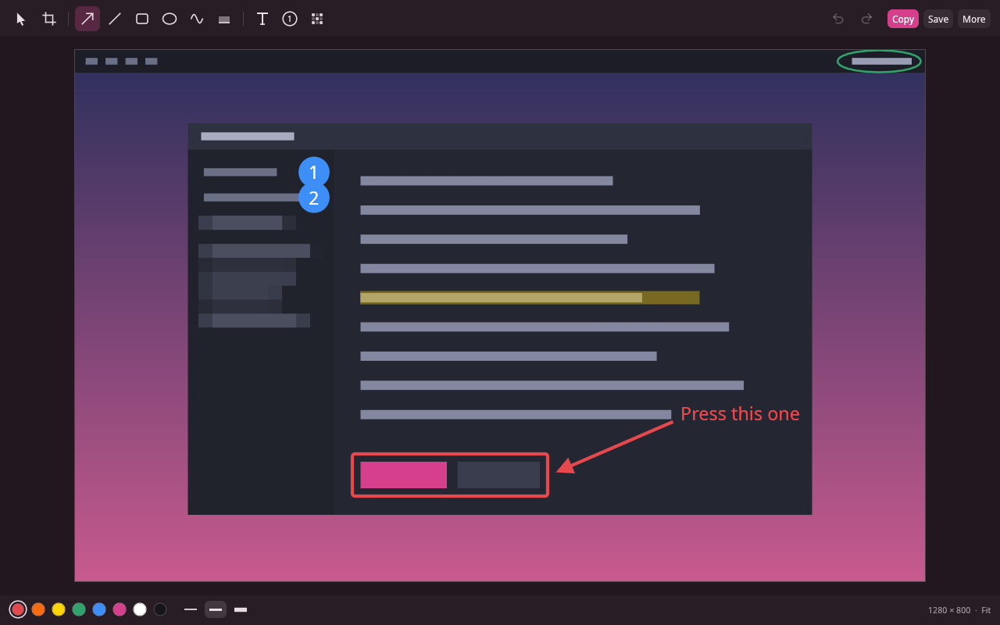

Rivet Snip clips and marks up screenshots: crop, arrows, boxes, text, numbered steps, a highlighter and blur, then copy or save.



## Marking up

Crop to the part that matters. The rest of the picture is kept until you save, so Undo brings it back. Then draw arrows, lines, boxes, ovals and freehand, highlight, type text, and place numbered circles that count up as you click.

Blur what shouldn't be read. The saved picture has squares of averaged color there, not a cover that could be lifted off.

Select a mark to drag it, give it another color or thickness, or remove it. Undo and Redo go through every change.

## Where the picture comes from

Snip doesn't need a particular compositor.

| How | What to run |
| --- | --- |
| A compositor that takes its own screenshots hands over the file | `rivet-snip FILE --replace` |
| The same, without a file | `… \| rivet-snip -` (a PNG on standard input) |
| Snip takes the picture itself | `rivet-snip capture` |
| From the clipboard | `rivet-snip --clipboard`, or `Ctrl+V` in the window |
| From a file manager | Open With on a PNG, JPEG or WebP, or drop one on the window |

`rivet-snip capture` uses `grim` on compositors that let programs read the screen (Sway, Hyprland, niri, Softcore and others with wlr-screencopy). On GNOME, KDE and the rest it asks the desktop for the picture. It opens on the Crop tool. `--delay SECONDS` waits first, for a menu that has to be open.

## Where Save writes

- Opened with `--replace`: over the file it was given.
- Opened from a file without `--replace`: a new file beside it, `NAME marked.png`.
- With no file: `Screenshot from DATE TIME.png` in `Pictures/Screenshots`, or the folder `save_dir` names.

Copy puts the finished picture on the clipboard as a PNG. With `wl-clipboard` installed it stays there after the window closes.

## Keys

| Keys | What |
| --- | --- |
| `V` / `C` | Select / Crop |
| `A` / `L` / `R` / `O` | Arrow / Line / Box / Oval |
| `P` / `H` | Pen / Highlighter |
| `T` / `N` / `B` | Text / Number / Blur |
| `Shift` while dragging | Lines at 45° steps; square boxes, ovals and blur |
| `Delete` | Remove the selected mark |
| `Ctrl+Z` / `Ctrl+Shift+Z` | Undo / Redo |
| `Ctrl+C` / `Ctrl+S` / `Ctrl+Shift+S` | Copy / Save / Save As |
| `Ctrl+scroll`, `Ctrl+0`, `Ctrl+1` | Zoom, fit, actual size |

## Settings

`~/.config/rivet-snip/settings`, as `key=value` lines: `theme`, `accent`, `follow_desktop_colors` and `text_size` as in the other apps, `save_dir`, and `close_after_copy`. The last color and thickness are kept there too.

## Get it

The current downloads are on the [Snip page](/snip/). Build from the repo with:

```sh
cargo build --release -p rivet-snip
./target/release/rivet-snip --install-desktop-entry
```

More is in the [Snip README](https://github.com/rivetsoft/apps/blob/main/apps/rivet-snip/README.md).
