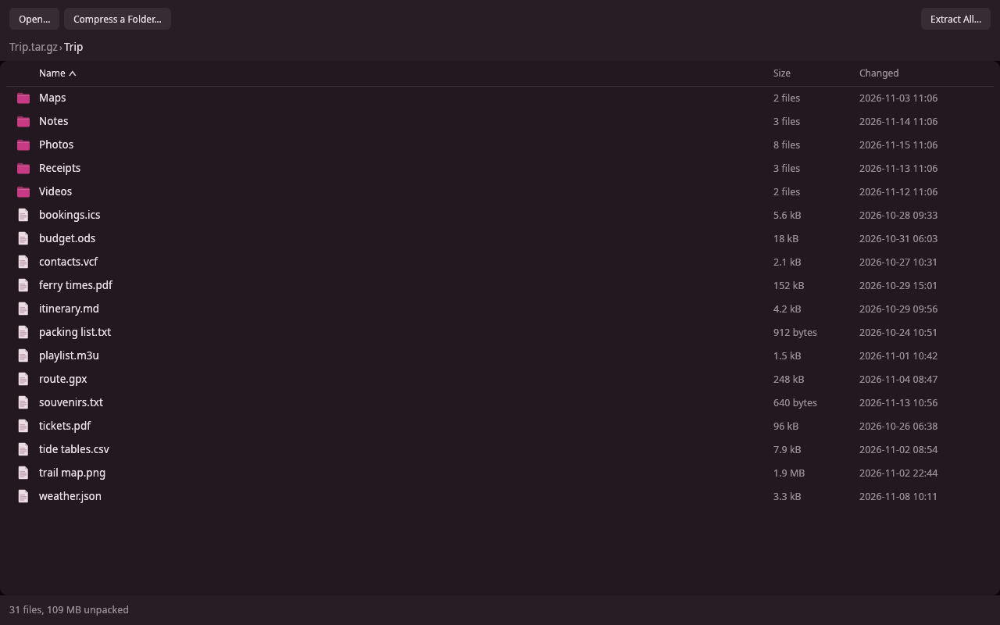

Rivet Vice opens an archive and shows what is in it, folder by folder. Take out all of it or only some, or make a new one.



## Opening

Vice opens zip, jar, tar (gz, xz, bz2, zst, lz), 7z, rar, iso, cab, deb and rpm, and single compressed files (gz, xz, bz2, zst). It runs the archive tools the computer already has (`zip`, `unzip`, `tar`, `7z`), so what it can open depends on which are installed.

Walk through the folders like a file manager. Each row shows its size and when it was last changed. Click a heading to sort by it. In Rivet Files, right-click an archive and choose **Open in Rivet Vice**.

## Taking things out

**Extract All** takes everything out into a folder you choose. An archive with one thing at its top comes out as that thing. One with several gets a folder named after the archive.

Select rows and **Extract Selected** takes out only those, keeping the folders they are in. Nothing already there is written over: a name that is taken gets a number after it.

## Making an archive

**Compress a Folder**, or drop files on the window, then choose the name and the kind: zip, tar.gz, tar.xz, tar.zst or 7z.

## Keys

| Key | What |
| --- | --- |
| `Ctrl+O` | Open an archive |
| `Ctrl+A` | Select everything in the folder shown |
| `Backspace`, `Alt+Up` | Go up a folder |
| `Escape` | Clear the selection |
| `Ctrl+click`, `Shift+click` | Add to the selection, or select a run |

## With no window

```sh
rivet-vice --extract-here ARCHIVE…
rivet-vice --extract-to FOLDER ARCHIVE…
rivet-vice --compress --format tar.gz FILE…
```

## Not yet

Adding to or deleting from an archive, opening a file straight from one, archives with a password, and archives split into parts.

## Get it

The current downloads are on the [Vice page](/vice/). Build from the repo with:

```sh
cargo build --release -p rivet-vice
./target/release/rivet-vice --install-desktop-entry
```

More is in the [Vice README](https://github.com/rivetsoft/apps/blob/main/apps/rivet-vice/README.md).
