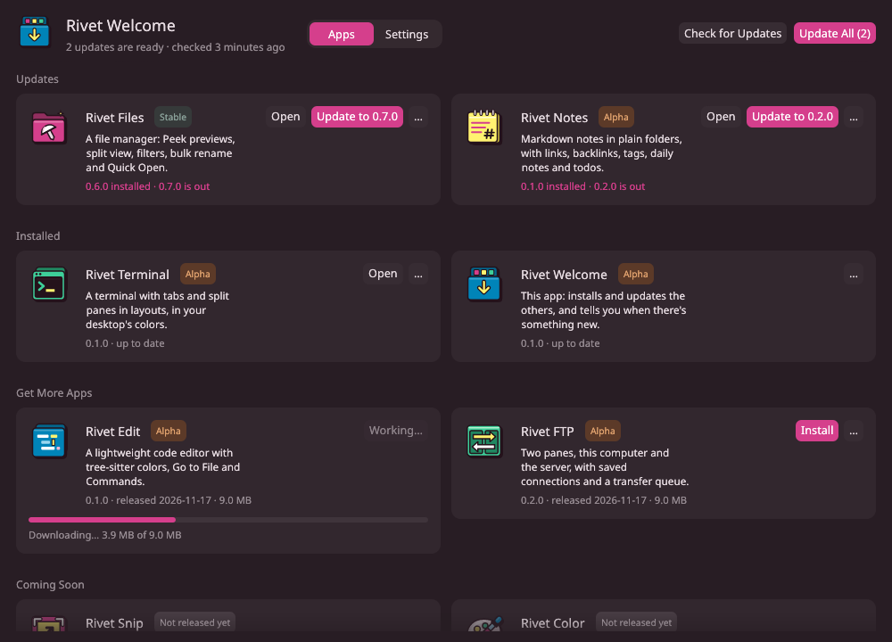
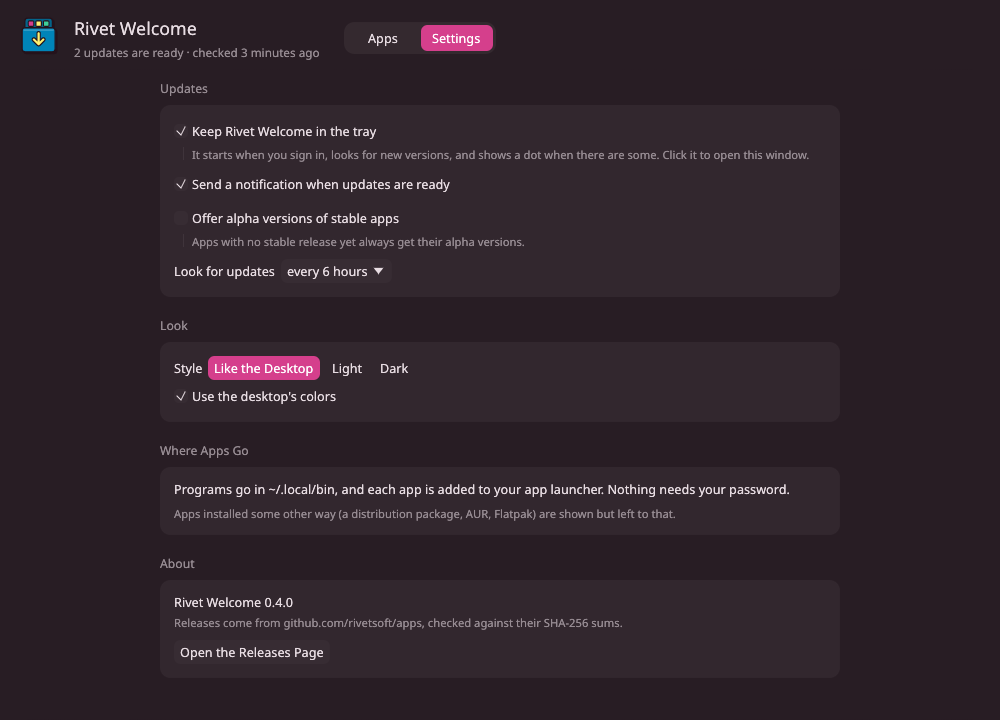

Rivet Welcome installs and updates the Rivet apps, and tells you when there's something new. It's optional: every app can still be installed by hand from its release. The current downloads are on the [Welcome page](/welcome/), and the usual way to start is its AppImage, from the [install page](/docs/getting-started/install/#get-started).



## The apps

Every Rivet app has a card: what's installed, what's out, and Install, Update, Open or Remove. The cards are grouped into Updates, Installed, Get More Apps and Coming Soon. Its badge says Stable or Alpha, from the release.

- **Install** puts the program in `~/.local/bin` and the app in your launcher. It doesn't ask for a password.
- **Update All** installs every update in turn.
- **Remove** (in the card's menu) takes the program, its launcher entry and its icon. Its settings and your documents stay.
- **What's New** (in the card's menu) shows the release notes.

An app released after your copy of Rivet Welcome shows up too, so nothing waits for Rivet Welcome to learn its name.

### Apps installed another way

An app installed by Flatpak, a distribution package, the AUR or a build in `/usr/local/bin` is shown with its version and where it came from, but never updated or removed here. Update it the way you installed it.

## Which versions

Rivet Welcome offers the stable version of every app that has one. Apps with no stable release yet, which are still alphas, get their alpha versions.

To get alpha versions of the stable apps too, turn on **Offer alpha versions of stable apps** in Settings. Alpha versions are newer and less tested: keep backups of what you use them with.



## What it checks

Rivet Welcome changes nothing until a download is complete and checked, so a failure leaves the version you had.

1. It looks for the archive with the app's exact name for this computer, and refuses a release that has no SHA-256 sum published beside it.
2. Before downloading, it checks there's room on the disk and that it can write to the folder the programs go in.
3. It downloads, carrying on from where it stopped if the connection drops (up to four tries), and checks the archive against its sum.
4. It runs the installer that comes in the archive, then asks the new program its version. If either fails, the version you had before is put back.

One app is worked on by one Rivet Welcome at a time, so the window, the tray and the terminal never install the same app at once.

## The tray

The tray icon starts when you sign in. It looks for new versions then and every few hours, shows a dot when there are some, and sends a notification once. Click it to open the window. Its menu has Check for Updates and Install Updates.

It works in Rivet Shell's panel and in any tray that speaks StatusNotifierItem, such as KDE's and waybar's. In Settings you can turn it off, turn off the notification, and choose how often it looks: every 3, 6 or 12 hours, every day, or only when you sign in.

## When something goes wrong

- **The download stopped.** It's tried four times, carrying on from where it stopped. If it still fails, the half download is kept in `~/.cache/rivet-welcome/downloads`, and the next try carries on from there.
- **"Doesn't match its checksum" or "has no checksum".** The archive is refused. Try again; if it keeps happening, the release itself is broken, so [report it](https://github.com/rivetsoft/apps/issues).
- **Not enough space, or the folder isn't yours to change.** Free some space, or fix the owner of `~/.local/bin`, and try again. Nothing was downloaded.
- **The installer failed.** The version you had is put back, and the message ends with the installer's last line of output.
- **GitHub's limit on checks is used up.** Without a token, GitHub answers 60 requests an hour from one address, and the message says when you can check again. To raise the limit to 5,000, set `GITHUB_TOKEN` to any GitHub token; it needs no scopes.
- **"Another Rivet Welcome is installing it".** Wait for the other one (the tray, the window or a terminal) to finish, then try again.

## From a terminal

```sh
rivet-welcome                # the window (and the tray, when it's on)
rivet-welcome --tray         # only the tray
rivet-welcome list           # every app: installed and released versions
rivet-welcome check          # look for updates (exit status 2 when there are some)
rivet-welcome install notes edit
rivet-welcome update         # install every update
rivet-welcome remove ftp
```

It needs `curl`, `tar` and `sha256sum`, which nearly every Linux system has.

## Where things are

| What | Where |
| --- | --- |
| Settings | `~/.config/rivet-welcome/settings` |
| The tray's sign-in entry | `~/.config/autostart/rivet-welcome-tray.desktop` |
| The last releases list | `~/.cache/rivet-welcome/releases.json` |
| Downloads in progress | `~/.cache/rivet-welcome/downloads` |
| Programs it installs | `~/.local/bin` (or `$XDG_BIN_HOME`) |

The [Welcome README](https://github.com/rivetsoft/apps/blob/main/apps/rivet-welcome/README.md) has the settings for testing against another repository.
